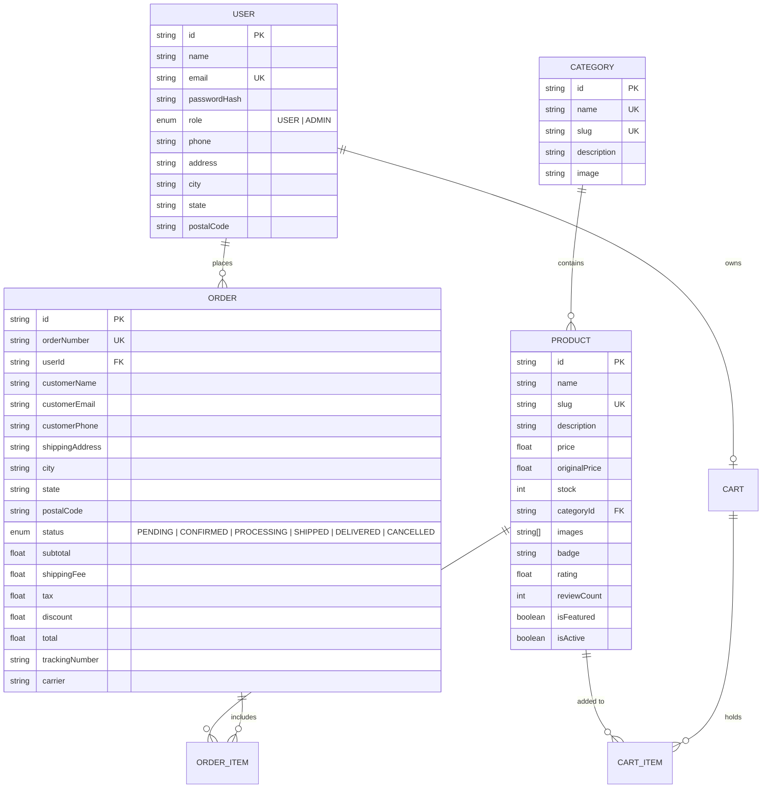

# NEXORA — Full-Stack E-Commerce Web Application
### *Discover More. Shop Smarter.*

[](https://opensource.org/licenses/MIT)
[](https://nodejs.org/)
[](https://reactjs.org/)
[](https://vitejs.dev/)
[](https://tailwindcss.com/)
[](https://prisma.io/)
[](https://www.postgresql.org/)

---

## 👨‍💻 Developer & Internship Information

- **Developer:** Alok Kumar Vishwas
- **Academic Profile:** B.Tech (2nd Year), Computer Science & Engineering (CSE)
- **Institution:** GL Bajaj Institute of Technology & Management, Greater Noida
- **Email:** [alokvishwas786@gmail.com](mailto:alokvishwas786@gmail.com)
- **GitHub Profile:** [@alok0204](https://github.com/alok0204)
- **Internship Organization:** Thiranex
- **Assigned Task:** Task 3 — Full-Stack E-Commerce Web Application
- **Project Name:** **NEXORA**
- **GitHub Repository:** [https://github.com/alok0204/ecommerce-web-app](https://github.com/alok0204/ecommerce-web-app)

---

## 🌟 Executive Overview

**NEXORA** is a full-stack e-commerce web platform engineered with modern architectural best practices. Designed as a high-end electronic lifestyle storefront, NEXORA provides customers with an interactive catalog, real-time cart synchronization, safe demo checkout, and 5-stage shipment tracking, alongside an administrative operations portal for managing inventory, categories, and customer orders.

### Core Architectural Highlights
1. **Dynamic Storefront:** 14+ engineered products across 5 curated categories (Electronics, Audio & Wearables, Accessories, Smart Home, Lifestyle) with high-resolution imagery and specifications.
2. **Dual-Mode Prisma Repository:** Seamless native integration with hosted PostgreSQL databases (Render/Neon) and persistent fallback for zero-downtime local execution.
3. **Inventory & Price Integrity:** Server-side pricing verification that prevents client tampering during checkout and executes atomic stock deductions.
4. **Role-Based Security:** Strict JWT authorization enforcing customer vs. administrator boundary. Public registration is locked to regular customers.
5. **Simulated Demo Checkout:** Complete checkout pipeline with real database order creation, promo coupon validation (`NEXORA10`, `WELCOME20`), and zero financial risk.
6. **5-Stage Courier Tracking:** Visual step-by-step shipment timeline tracking (`Pending` → `Confirmed` → `Processing` → `Shipped` → `Delivered`).
7. **Administrative Command Center:** Real-time analytics, revenue calculation, low-stock warnings, inventory editing, and order status updates.

---

## 🛠️ Technology Stack

| Layer | Technologies & Tools |
| :--- | :--- |
| **Frontend UI** | React 18, Vite 5, Tailwind CSS, Lucide React, Framer Motion, Canvas Confetti |
| **Routing & State** | React Router v6, React Context API (`AuthContext`, `CartContext`), LocalStorage Persistence |
| **Backend API** | Node.js (ES Modules), Express.js, Helmet, Morgan, Express Rate Limit, CORS |
| **Database & ORM** | PostgreSQL, Prisma ORM 5, Persistent Repository Adapter |
| **Authentication** | JSON Web Tokens (JWT), Bcrypt.js (10-round salted password hashing) |
| **DevOps & Cloud** | Git, GitHub CLI, Vercel (`vercel.json`), Render Web Service (`render.yaml`), Neon PostgreSQL |

---

## 📦 Database Schema & Models

The application's PostgreSQL database schema is modeled via Prisma (`server/prisma/schema.prisma`):



---

## 🚀 Key Application Features

### 🛒 Customer Storefront
- **Hero & Curated Collections:** Modern landing page with interactive department badges, value propositions, and staff-picked electronics.
- **Search & Filtering:** Instant keyword query, category filtering, price sliders, stock availability toggles, and multi-criteria sorting (Price Low/High, Rating, Newest).
- **Product Details:** High-resolution image galleries, technical specs table, stock-level indicators, quantity selector, and related product suggestions.
- **Shopping Cart:** Slide-over cart drawer and dedicated Cart Page with free-shipping tracker ($50 threshold) and promo code support.
- **Demo Checkout:** Full shipping form with validation, delivery speed selection (Standard vs. Express), and simulated payment methods (Card, UPI, COD).
- **Instant Confetti Confirmation:** Order confirmation with printable receipt and direct tracking link.
- **Live Order Tracking:** Public tracking portal where any customer can query their `NX-XXXXXX` order or `TRK-XXXX` tracking code to view the live 5-stage progress.
- **Customer Account:** View previous orders, delivery destinations, and update profile address information.

### 🛡️ Administrative Portal (`/admin`)
- **Executive Dashboard:** Live KPIs (Total Revenue, Orders, Products, Customers, Low Stock Alerts) and recent transactions.
- **Product & Inventory Management:** Create new products, edit titles, update prices, adjust stock units in real-time, or archive items.
- **Order Management & Status Updater:** Search all customer orders and immediately transition status (`PENDING` → `CONFIRMED` → `PROCESSING` → `SHIPPED` → `DELIVERED` → `CANCELLED`).
- **Category Control:** View department product counts, add new categories, and update metadata.

---

## 🔑 Demo Credentials

For quick evaluation and grading, the login page features single-click **Quick Fill** buttons:

| Role | Email | Password | Access Privileges |
| :--- | :--- | :--- | :--- |
| **Administrator** | `admin@nexora.com` | `Admin@Nexora2026!` | Full Admin Portal, Inventory CRUD, Order Management |
| **Demo Customer** | `demo@customer.com` | `Customer@123` | Storefront, Shopping Cart, Checkout, Order Tracking |

---

## 📡 REST API Reference

All backend routes are prefixed with `/api`. Rate limiting (300 req / 15 min) is enforced across the application.

### Authentication & User
- `POST /api/auth/register` — Create new customer account (always `USER` role)
- `POST /api/auth/login` — Sign in and receive JWT token
- `GET /api/auth/me` — Retrieve current authenticated user profile
- `PUT /api/auth/profile` — Update recipient name, phone, or delivery address
- `GET /api/auth/admin-status` — Check whether administrator account is provisioned

### Products & Categories
- `GET /api/products` — Query products with filters (`category`, `search`, `minPrice`, `maxPrice`, `sort`, `inStock`)
- `GET /api/products/featured` — Get featured items for homepage
- `GET /api/products/:identifier` — Get detailed product info by slug or ID with related items
- `GET /api/categories` — Get all product categories with item count
- `GET /api/categories/:slug` — Get single category details

### Shopping Cart (Authenticated)
- `GET /api/cart` — Retrieve user's synchronized cart
- `POST /api/cart/add` — Add product to cart with quantity check
- `PUT /api/cart/item/:id` — Update line item quantity
- `DELETE /api/cart/item/:id` — Remove item from cart
- `DELETE /api/cart/clear` — Clear entire cart

### Orders & Tracking
- `POST /api/orders/checkout` — Validate inventory, calculate server totals, and create persistent order
- `GET /api/orders/my-orders` — Get all orders placed by authenticated user
- `GET /api/orders/track?query=NX-XXXXXX` — Public courier shipment tracking & 5-stage timeline
- `GET /api/orders/:identifier` — Get complete order invoice by orderNumber or ID

### Admin Operations (Requires `ADMIN` Role)
- `GET /api/admin/stats` — Executive dashboard metrics and low-stock list
- `GET /api/admin/orders` — Filter and view all customer orders
- `PUT /api/admin/orders/:id/status` — Update order fulfillment state (`PENDING`..`DELIVERED`)
- `POST /api/admin/products` — Create new catalog item
- `PUT /api/admin/products/:id` — Update existing product or inventory stock
- `DELETE /api/admin/products/:id` — Delete product
- `POST /api/admin/categories` — Create category
- `PUT /api/admin/categories/:id` — Update category

---

## 💻 Local Setup & Installation

### Prerequisites
- **Node.js** (v18 or higher recommended; developed on Node v24.19.0)
- **npm** (v9 or higher)
- **Git**

### 1. Clone the Repository
```bash
git clone https://github.com/alok0204/ecommerce-web-app.git
cd ecommerce-web-app
```

### 2. Install Dependencies
```bash
# Install root, backend, and frontend dependencies
npm run install:all
```
*(Or navigate to `server/` and `client/` individually and run `npm install`)*

### 3. Configure Environment Variables
Create `.env` inside `server/` (or copy from `server/.env.example`):
```env
PORT=5000
NODE_ENV=development
JWT_SECRET=nexora_production_jwt_secret_key_alok_kumar_vishwas_thiranex_task3
DATABASE_URL=
FRONTEND_URL=http://localhost:5173
```
*(Note: If `DATABASE_URL` is empty, NEXORA seamlessly initializes its persistent local database at `server/data/nexora-db.json` with zero configuration required!)*

### 4. Generate Prisma & Seed Database
```bash
npm --prefix server run prisma:generate
npm --prefix server run prisma:seed
```

### 5. Launch Application
In two separate terminals (or using concurrently):
```bash
# Terminal 1: Backend Server (Port 5000)
npm run dev:server

# Terminal 2: Frontend Client (Port 5173)
npm run dev:client
```
Visit **`http://localhost:5173`** in your browser.

---

## 🌐 Production Deployment

### 1. Frontend on Vercel
- NEXORA includes a production-ready `vercel.json` with client-side SPA route rewrites:
  ```json
  {
    "buildCommand": "cd client && npm install && npm run build",
    "outputDirectory": "client/dist",
    "framework": "vite",
    "rewrites": [{ "source": "/(.*)", "destination": "/index.html" }]
  }
  ```
- Environment Variable in Vercel:
  - `VITE_API_URL` = `https://nexora-api.onrender.com` (Your backend URL)

### 2. Backend & PostgreSQL on Render
- NEXORA includes a Blueprint `render.yaml` configuring:
  - Web Service: `nexora-api` (Node.js)
  - Managed PostgreSQL Database: `nexora-db`
  - Automatic `DATABASE_URL` injection, migrations, and health check route `/api/health`.

---

## 🛡️ Academic & Ethical Notice

This software is developed by **Alok Kumar Vishwas** exclusively for the **Thiranex Full-Stack Web Development Internship (Task 3)**. All payments, order numbers, and tracking references generated by this website are simulated for educational demonstration.

---
© 2026 Alok Kumar Vishwas. All Rights Reserved.
